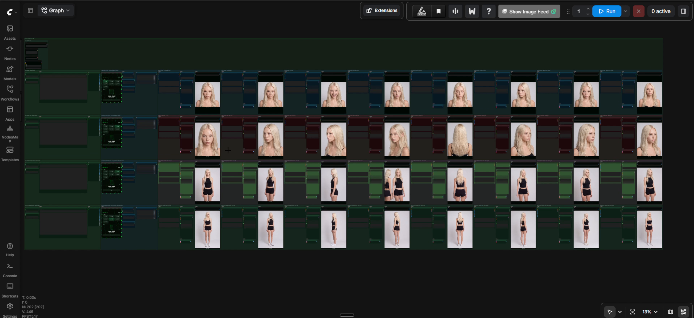
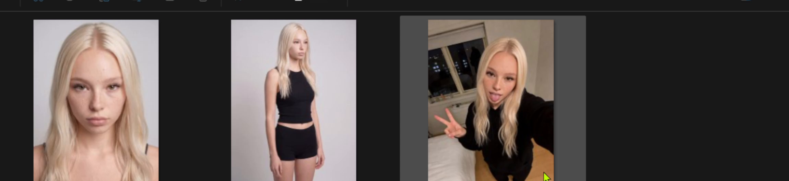
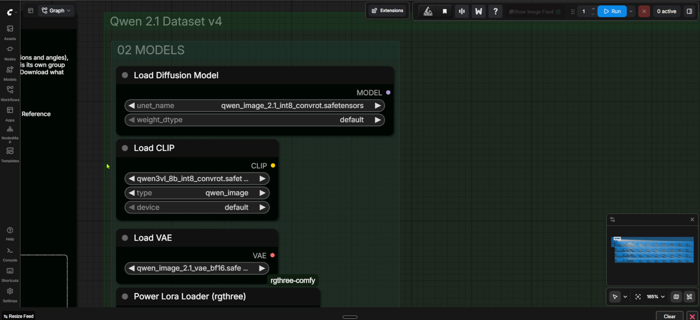
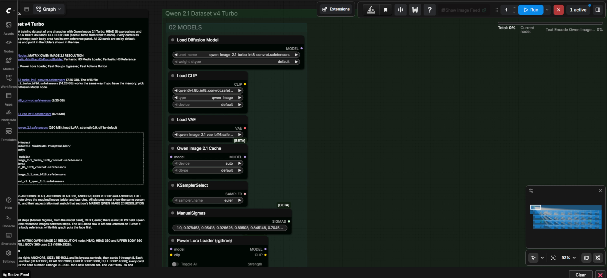
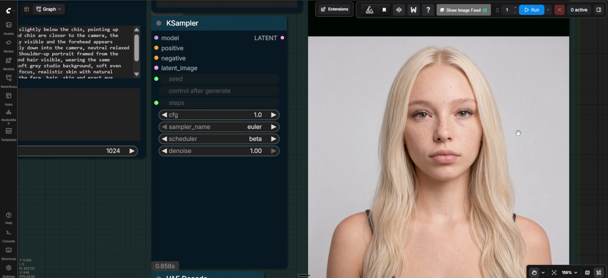

# MATRIX Qwen Image 2.1 Dataset Workflow — V4

Build a local 32-picture character dataset in ComfyUI from a small set of reference pictures.

**First public release · package version 1.0.0 · Normal 25-step and Turbo 8-step workflows · ready to configure**

> [!IMPORTANT]
> This repository contains only the two MATRIX Qwen Image 2.1 Dataset V4 workflows and their setup documentation. It does not include model weights, ComfyUI, or the complete MATRIX LAB node collection. Qwen Image 2.1 weights use the Qwen Research License and are limited to non-commercial use unless you obtain separate permission.

[Install it yourself](INSTALL.md) · [AI-agent installation](AGENT-INSTALL.md) · [Models and licenses](MODELS.md) · [Normal contract](workflows/normal/AGENTS.md) · [Turbo contract](workflows/turbo/AGENTS.md)

## What it builds

Three core reference pictures can define the face, body, and an extra view. The workflow expands them into four rows of eight pictures:

1. **HEAD** — expressions and camera angles
2. **HEAD 360** — eight views around the head
3. **UPPER BODY 360** — eight upper-body views
4. **FULL BODY 360** — eight full-body views

The output is approximately 2K. The supplied section presets are `1792 × 2400` for HEAD, HEAD 360, and UPPER BODY 360, and `1696 × 2528` for FULL BODY 360.

## Choose a workflow

| Workflow | Sampling | Use it when |
| --- | --- | --- |
| [Normal](workflows/normal/MATRIX-Qwen21-Dataset-V4.json) | 25 steps, Euler, beta scheduler | You want the base Qwen Image 2.1 path. |
| [Turbo](workflows/turbo/MATRIX-Qwen21-Dataset-V4-Turbo.json) | 8 fixed steps, Euler, manual sigmas | You want the Qwen Image 2.1 Turbo checkpoint and cache path. |

No measured speed-up is claimed. Actual runtime depends on hardware, ComfyUI, custom-node versions, model format, and enabled cards.

## Picture order matters

- **Picture 1 is the face anchor.**
- **Picture 2 is the body/outfit anchor** where that section needs one.
- Add further pictures only as optional views of the same character. The full-body row can also use a dedicated full-body picture before optional views.
- Fill slots without gaps. Picture tags are assigned from active pictures in order.
- Use the same character and compatible clothing in every reference.
- The aspect ratio selected in each **MATRIX QWEN IMAGE 2.1 RESOLUTION** node must match that section's input-picture aspect ratio.

Neutral local filenames such as `face.png`, `body.png`, and `extra.png` are used in the documentation. The distributed workflows contain no reference pictures or local filenames.

## Models and optional LoRAs

The Normal workflow selects the base INT8 checkpoint; Turbo selects the Turbo INT8 checkpoint. Both use the same Qwen3-VL text encoder and Qwen Image 2.1 VAE. See [MODELS.md](MODELS.md) for exact filenames, folders, pinned download links, and licenses.

The Normal workflow includes two optional LoRA rows, both **off by default**:

- BFS head LoRA at strength `0.9`
- Pruna 8-step LoRA at strength `1.0`

They are not required for the documented 25-step Normal path. Turbo contains only the optional BFS row, also off by default.

## Safe start

1. Follow [INSTALL.md](INSTALL.md) and keep any existing ComfyUI installation intact.
2. Install the three pinned custom-node commits.
3. Place the required model files in the exact folders from [MODELS.md](MODELS.md).
4. Load one workflow JSON in ComfyUI.
5. Add your references in order, confirm the aspect ratio, and enable only the rows you want.
6. Review all 32 prompts and output folders before queueing.

Each enabled card saves one PNG below the configured ComfyUI output directory in `dataset/head`, `dataset/head360`, `dataset/upper360`, or `dataset/full360`.

## Scope and maturity

This is the first public package of the V4 graphs. The Normal graph was shown producing the pictured 32-image set. The Turbo graph preserves the same prompts and layout while changing the model and sampler path; this repository does not claim broad hardware compatibility, output identity between variants, or a measured performance improvement. Review generated datasets before training.

Use only AI-generated characters or images for which you have the necessary rights and consent. Installation and static verification do not authorize image generation.

## License and security

The workflow JSON and original repository documentation are licensed under [Apache License 2.0](LICENSE). Model weights and third-party custom nodes retain their own licenses. No weights or third-party source are redistributed here. Read [NOTICE](NOTICE) and [SECURITY.md](SECURITY.md).
